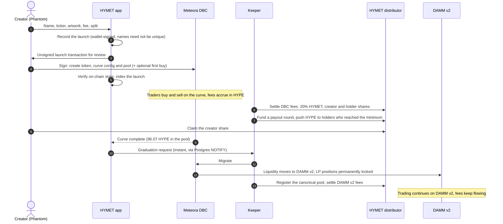
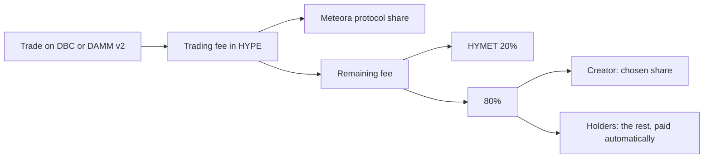
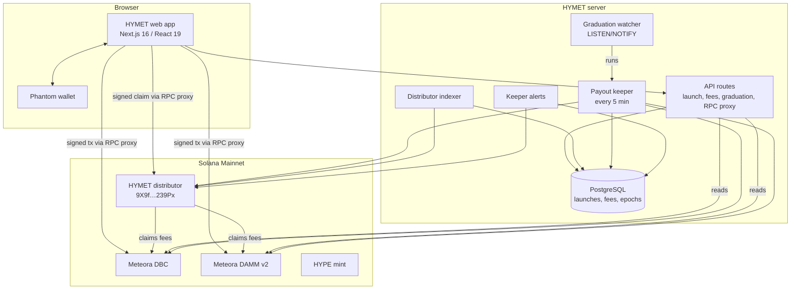

<p align="center">
  
</p>

<p align="center">
  <b>A HYPE-only token launchpad on Solana.</b><br>
  Fixed-supply launches on a Meteora Dynamic Bonding Curve, automatic migration to a permanently locked
  Meteora DAMM v2 pool, and trading fees split on-chain between HYMET, creators and holders.
</p>

<p align="center">
  <a href="https://x.com/Hymetdotfun"></a>
  
  
  
  
</p>

---

## Contents

- [What HYMET is](#what-hymet-is)
- [How a launch works](#how-a-launch-works)
- [Where the fees go](#where-the-fees-go)
- [Architecture](#architecture)
- [On-chain addresses](#on-chain-addresses)
- [Verify the deployed program](#verify-the-deployed-program)
- [Repository map](#repository-map)
- [Run it locally](#run-it-locally)
- [Documentation](#documentation)
- [Security](#security)
- [License](#license)

## What HYMET is

HYMET launches Solana tokens paired only with **HYPE**. Every launch uses the same fixed recipe, enforced by the app
and checked on-chain, so traders can compare launches like for like:

| | |
|---|---|
| **Supply** | Fixed at 1,000,000,000 tokens, 9 decimals; token authority immutable, no HYMET launch fee |
| **Curve** | Meteora Dynamic Bonding Curve (DBC), starting at a 33.5 HYPE market cap |
| **Graduation** | At a 447 HYPE market cap (96.07 HYPE raised), liquidity migrates to Meteora DAMM v2 |
| **Liquidity after graduation** | 100% permanently locked; nobody can withdraw it |
| **Trading fee** | Chosen per launch between 0.25% and 3% (default 1%), paid in HYPE before and after graduation |
| **Fee split** | Fixed per launch at creation and enforced on-chain (see [below](#where-the-fees-go)) |

Thresholds are fixed in HYPE, so a launch graduates on the same HYPE amount whatever HYPE's USD price is.
[Launch economics](docs/LAUNCH-ECONOMICS.md) has the exact curve figures.

The website, [hymet.fun](https://hymet.fun), is public. Launches, trading and claims through it are not open yet and show
Launching Soon.

## How a launch works



The distributor steps apply to launches with a holder share. In a 100% creator launch, Meteora pays HYMET and the creator
directly. Graduation and DAMM v2 have not yet run on Mainnet; see [What has been verified](#what-has-been-verified-on-mainnet).

## Where the fees go

Meteora keeps its protocol share of every trading fee. HYMET's share of the rest is **always 20%**; the remainder
goes to the creator, or is split between the creator and the token's holders.



Each launch takes one of two on-chain routes, decided by its split. Production offers both; public launches are not open
yet.

| Route | Used when | How the 80% is handled |
|---|---|---|
| **Native split** | The creator keeps 100% of the 80% | Meteora pays HYMET (20%) and the creator (80%) directly; after graduation each owns a permanently locked LP position |
| **Distributor** | The launch has any holder share | All fees go to the HYMET distributor program, which pays HYMET 20% and lets the creator claim their share. The keeper pushes the holders' share at most every 15 minutes per token, once a wallet reaches its payout minimum |

The distributor holds no keys of its own: its fee pool is a program-derived address that can only claim Meteora fees
and pay them out by the fixed rules. See [Distributor program](docs/DISTRIBUTOR.md).

## Architecture



- **The app never holds user keys.** The server builds and simulates unsigned transactions; Phantom signs; the app
  checks the signed message against the one you reviewed before it is sent. It must be byte-for-byte identical, except
  that swaps and fee claims accept Lighthouse assertions added by Phantom; every reviewed instruction must stay unchanged.
- **The keeper holds one narrow key**: the distributor's snapshot authority. It can register the canonical DAMM v2 pool,
  and fund and close holder payout rounds from fees already collected for holders. It cannot reach HYMET's or creators'
  shares or the liquidity. The program checks payments against the round's Merkle root, not token balances, so holders
  rely on the keeper to compute recipients correctly. See [Keeper](docs/KEEPER.md).
- **Operator routes stay off the public site.** The owner console and test-network routes are not served at hymet.fun.

## On-chain addresses

| What | Address |
|---|---|
| HYMET distributor program | [`9X9fnj4Uh9WC9nmxCahTVsixHZ6VGxNpMesuGhK239Px`](https://solscan.io/account/9X9fnj4Uh9WC9nmxCahTVsixHZ6VGxNpMesuGhK239Px) |
| Distributor config | [`5QMrhkg36hnJVBubARNLrL8vPaCb9koRYLeffVc8GNHG`](https://solscan.io/account/5QMrhkg36hnJVBubARNLrL8vPaCb9koRYLeffVc8GNHG) |
| Upgrade authority / admin | [`9G9v3Ax4K2prmVQfDzp2HY6YYZ5UFmCo24761pgEmMo7`](https://solscan.io/account/9G9v3Ax4K2prmVQfDzp2HY6YYZ5UFmCo24761pgEmMo7) |
| HYMET platform fee wallet | [`7sAoyG3ZdewKrZKLzU8VTpfzNh6YuJKQAgnWjgjSqPEs`](https://solscan.io/account/7sAoyG3ZdewKrZKLzU8VTpfzNh6YuJKQAgnWjgjSqPEs) |
| Keeper (snapshot authority) | [`GHZHuBqZvmixBDHsApwEJeW3dCgR1p39UPNszHeuoL8S`](https://solscan.io/account/GHZHuBqZvmixBDHsApwEJeW3dCgR1p39UPNszHeuoL8S) |
| HYPE mint | [`98sMhvDwXj1RQi5c5Mndm3vPe9cBqPrbLaufMXFNMh5g`](https://solscan.io/token/98sMhvDwXj1RQi5c5Mndm3vPe9cBqPrbLaufMXFNMh5g) |
| Meteora DBC | `dbcij3LWUppWqq96dh6gJWwBifmcGfLSB5D4DuSMaqN` |
| Meteora DAMM v2 | `cpamdpZCGKUy5JxQXB4dcpGPiikHawvSWAd6mEn1sGG` |

These values are pinned in [`config/production.json`](config/production.json); the app and keeper refuse to run if
the chain disagrees.

## Verify the deployed program

The deployed distributor is reproducible from this repository, byte for byte:

```bash
solana program dump 9X9fnj4Uh9WC9nmxCahTVsixHZ6VGxNpMesuGhK239Px deployed.so -u mainnet-beta
sha256sum deployed.so
# fda10de4da728442da4a42a63bb1f5d8df614e49f8421c656ee2ca67f3be3e7b  (509,112 bytes)
```

[Verify the build](docs/VERIFY-BUILD.md) shows how to rebuild that exact binary from source with Solana CLI 2.2.1.

## Repository map

```text
app/                Next.js routes: launch, explore, token pages, fees, dashboard, docs, owner console, API
components/         UI components (launch form, trade panel, fee ledger, owner console, ...)
lib/                Core logic: DBC/DAMM v2 transactions, fee accounting, distributor client, keeper, indexer
programs/           HYMET distributor (Anchor 0.31.1, Rust)
migrations/         PostgreSQL schema, applied in order by `npm run db:migrate`
scripts/            Keeper, indexer, graduation watcher, alerts, deployment and verification tooling
config/             production.json: the pinned Mainnet addresses and reviewed program hash
tests/              Vitest suite (TypeScript) covering transactions, fees, keeper, indexer and guards
vendor/             Bounds-checked pure-JS replacement for bigint-buffer (GHSA-3gc7-fjrx-p6mg)
docs/               Technical documentation
```

## Run it locally

Requirements: Node.js 20 or newer (production runs 24), PostgreSQL 16, and (for the program) Rust with Solana CLI
2.2.1.

```bash
npm ci                       # .npmrc keeps install scripts off (ignore-scripts=true)
# create .env.local with DATABASE_URL and the public addresses (see docs/DEVELOPMENT.md); Mainnet stays off by default
npm run db:migrate
npm run dev                  # http://127.0.0.1:4173
npm test                     # Vitest
npm run typecheck && npm run lint
```

The web app's Mainnet transactions stay disabled until both `NEXT_PUBLIC_ENABLE_MAINNET` and `ENABLE_MAINNET` are
`true`. The keeper has its own settings; see [Keeper](docs/KEEPER.md). For
end-to-end testing against a local Mainnet fork, see [Local test network](docs/LOCAL-TEST-NETWORK.md);
[Development](docs/DEVELOPMENT.md) covers the rest.

## Documentation

| Document | What it covers |
|---|---|
| [Architecture](docs/ARCHITECTURE.md) | Components, data flow, trust boundaries, transaction safety |
| [Distributor program](docs/DISTRIBUTOR.md) | Accounts, instructions, fee math, holder payouts, security properties |
| [Keeper](docs/KEEPER.md) | Graduation, settlement, snapshots, payouts, scheduling, alerts |
| [Launch economics](docs/LAUNCH-ECONOMICS.md) | Curve parameters, graduation thresholds, costs |
| [Verify the build](docs/VERIFY-BUILD.md) | Reproduce the deployed binary from source |
| [Development](docs/DEVELOPMENT.md) | Setup, configuration, tests, scripts |
| [Allocation API](docs/ALLOCATION-API.md) | Creator/holder allocation inputs and checks |
| [Local test network](docs/LOCAL-TEST-NETWORK.md) | Running the app against a local Mainnet fork |

## Security

Please report vulnerabilities privately; see [SECURITY.md](SECURITY.md). Do not open public issues for security
problems.

The distributor program has had an internal security review and a reproducible build. It has **not** had an external
audit. Trading launched tokens carries market risk; nothing here is financial advice.

### What has been verified on Mainnet

**Verified on Mainnet**, with real HYPE on HYMET's own test tokens:

- Launches through the distributor (50/50 split, at 1% and 2% trading fees) and the native route
- Buying and selling on Meteora DBC with Phantom
- Keeper settlement of DBC fees, including the 20% HYMET share and the creator and holder split
- Creator claims from the distributor
- Funded holder payouts to wallets that already had a HYPE account: one round on each of two tokens
- Recording carried amounts for wallets below their minimum, with original balances proven against the on-chain snapshot
- Exact reconciliation of chain state, database records and wallet payments

**Devnet, local validator or tests only**, not yet run on Mainnet:

- Graduation, DBC-to-DAMM v2 migration and canonical pool registration, at a 1% fee only
- DAMM v2 trading and DAMM v2 fee settlement
- Any distributor split other than 50/50, including 0% creator / 100% holders
- Repeated payout rounds on one token at the 15-minute interval, and a carried amount growing until it is paid
- Keeper-created HYPE accounts at the 0.05 HYPE minimum
- Paying carried amounts to wallets that have sold (simulated only)
- Native-route creator claims and platform claims

Phantom is the only wallet tested in any environment.

## License

HYMET is licensed under the [Apache License 2.0](LICENSE). Third-party material in this repository keeps its own
license; see [NOTICE](NOTICE).
