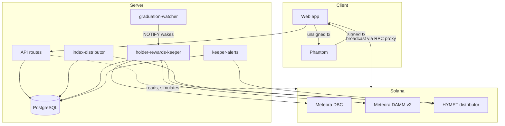

# Architecture

HYMET is a Next.js application, a PostgreSQL index, a small set of server processes, and one Solana program. Meteora's
Dynamic Bonding Curve (DBC) and DAMM v2 programs do the trading; HYMET builds and checks the transactions, indexes the
results, and (in distributor mode) splits the fees.

## Components

| Component | Where | Role |
|---|---|---|
| Web app | `app/`, `components/` | Launch form, explore, token pages with DBC/DAMM v2 trading, fees and rewards, creator dashboard, owner console |
| API routes | `app/api/` | Reservations, launch confirmation, metadata upload, fee and claim transactions, graduation requests, RPC proxy |
| Core library | `lib/` | Curve config (`config.ts`), transaction building and review (`transactions.ts`, `wallet-operation.ts`), DBC/DAMM v2 swaps and fees, distributor client, keeper logic, indexer |
| Database | `migrations/` | Launches, pools, reservations, trades and market snapshots, fee accruals and settlements, payout epochs and entitlements, graduation requests |
| Distributor program | `programs/hymet-rewards-distributor` | On-chain fee custody and split; see [DISTRIBUTOR.md](DISTRIBUTOR.md) |
| Keeper | `scripts/holder-rewards-keeper.ts`, `lib/holder-keeper.ts` | Migration, canonical pool registration, settlement, holder snapshots and payouts; see [KEEPER.md](KEEPER.md) |
| Graduation watcher | `scripts/graduation-watcher.mjs` | Runs the keeper for a mint the moment its curve completes (PostgreSQL `LISTEN hymet_graduation`) |
| Indexer | `scripts/index-distributor.mjs`, `lib/distributor-index.mjs` | Decodes confirmed distributor events into the database, idempotently |
| Alerts | `scripts/keeper-alerts.mjs`, `lib/keeper-alerts.mjs` | Failed or stale keeper runs, low keeper SOL, stalled settlement or graduation, overdue or stuck payouts, unexpected funded epochs; Telegram or webhook delivery |

## Transaction safety

Every user transaction follows the same path:

1. **Build on the server.** The server builds the transaction from on-chain state and the fixed HYMET policy, then
   simulates it. It never holds or sees a user key.
2. **Review.** The page shows what the transaction does (amounts, accounts, fees) before Phantom opens.
3. **Sign in Phantom.** The wallet returns the signed transaction.
4. **Compare.** The app requires the signed message to be **byte-for-byte** identical to the reviewed one, except that
   swaps and fee claims accept assertion instructions from the Lighthouse program, which Phantom may add, when every
   reviewed instruction, account permission, fee payer, blockhash and compute setting is unchanged (`lib/wallet-guards.ts`).
   Owner operations and transactions another key has already signed stay byte-for-byte. Every
   signature to verify. Any change (for example a wallet-inserted fee instruction) aborts before broadcast, and the
   returned signature is journaled so a retry first checks its on-chain status.
5. **Simulate again, send once, confirm.** No automatic re-sends of an ambiguous broadcast.

Swap, claim, fee and owner transactions set an explicit compute-unit price, so the wallet has no reason to modify them.

## Network gates

Mainnet transactions are off unless **both** `NEXT_PUBLIC_ENABLE_MAINNET` (browser) and `ENABLE_MAINNET` (server)
are `true`; a mismatch disables them. Further gates:

| Gate | Effect when off |
|---|---|
| `HYMET_LAUNCH_MODE=native-split` | Launches use Meteora's native 20/80 split; the distributor path is unavailable |
| `HYMET_DISTRIBUTOR_VERIFIED`, `HYMET_DISTRIBUTOR_APP_VERIFIED` | Distributor launches and claims stay disabled |
| `HYMET_HOLDER_PAYOUTS_VERIFIED`, `NEXT_PUBLIC_HYMET_HOLDER_REWARDS` | Holder allocations are not offered and not described as automatic |
| Keeper `--send` | The keeper only plans and simulates |

Reservations and metadata uploads are refused while launches are closed. A local Mainnet-fork mode
([LOCAL-TEST-NETWORK.md](LOCAL-TEST-NETWORK.md)) can never fall back to Mainnet.

## Trust boundaries

| Party | Can | Cannot |
|---|---|---|
| Creator | Choose name, ticker, fee (0.25–3%) and creator/holder split at launch; claim creator fees | Change the split later, withdraw liquidity, mint more supply |
| HYMET server | Build and simulate transactions, index data | Sign for users; move user funds |
| Keeper key | Fund and close holder payout rounds from HYPE already collected for holders; register the canonical DAMM v2 pool | Touch HYMET's or creators' shares, liquidity, or anything outside the holder pool |
| Upgrade authority | Upgrade the distributor, rotate the keeper key | Bypass the program's rules without an upgrade (an upgrade is visible on-chain) |
| Meteora | Operate DBC and DAMM v2, take its protocol fee share | — |

## Pinned configuration

`config/production.json` pins the Mainnet program ID, wallets, HYPE mint, Meteora program IDs and the reviewed program
hash. The app, keeper, owner console and deployment scripts compare live chain state with it and refuse to proceed on
any difference.
