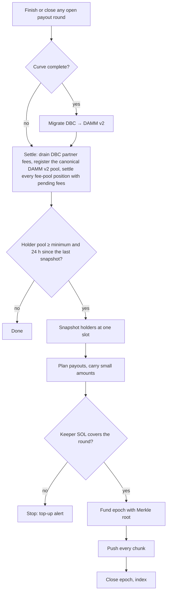

# Keeper

The keeper is a server process that completes the parts of a launch's life no user transaction covers: migrating a
graduated curve, registering the canonical DAMM v2 pool, collecting fees, and paying holders.

```bash
npm run rewards:keeper                                  # plan and simulate only
npm run rewards:keeper -- --send                        # broadcast (Mainnet needs every gate open)
npm run rewards:keeper -- --send --payout-interval-hours=24 --min-payout=<base units>
```

## One run, per distributor token



Every step resumes from chain state, so a failed or interrupted run is simply finished by the next one.

- **Settlement** is skipped when nothing is collectible. Up to 6 settlements run per token per run, so extra
  positions someone adds to the fee pool cannot exhaust the keeper's SOL.
- **Snapshots** run at most once per `--payout-interval-hours` (default 24) per token, while migration and settlement
  run on every tick.
- **SOL guard.** A round is funded only if the keeper holds its planned fees, new holder-account rent and epoch rent,
  plus 0.005 SOL of headroom.
- **Transactions** carry a priority fee (`HYMET_KEEPER_PRIORITY_MICROLAMPORTS`, default 20,000) and are rebroadcast
  with the same signature until confirmed or expired; a broadcast is never replayed after a transport error.

## Instant graduation

When a buy completes a curve, the app records a `graduation_requests` row. Its trigger issues
`NOTIFY hymet_graduation`; the watcher (`scripts/graduation-watcher.mjs`) wakes and runs the keeper for that mint only,
serialized with the periodic run by a file lock. The periodic run remains the fallback.

## Scheduling

| Unit | Schedule |
|---|---|
| Keeper | Every 5 minutes, after the indexer |
| Graduation watcher | Long-running |
| Alerts (`scripts/keeper-alerts.mjs`) | Every 5 minutes |

Run them under a dedicated system user that alone can read the keeper key, with a read-only code tree and only the
state directory writable.

## Alerts

`scripts/keeper-alerts.mjs` prints one JSON line, exits 1 when an alert fires and can POST to
`HYMET_ALERT_WEBHOOK_URL`:

| Alert | Condition |
|---|---|
| `keeper-failed` / `keeper-stale` / `keeper-no-status` | Last full run had errors, or none finished in 30 minutes |
| `keeper-sol-low` | Keeper balance below 0.05 SOL |
| `epoch-open-too-long` | A payout round open for more than 48 hours |
| `unexpected-epoch` | A round funded on-chain that matches no keeper-prepared root: treat as a keeper-key compromise, stop the keeper and rotate the key in the owner console |

## Costs

Per token per day with up to 6 holders, settlement plus one payout round costs about 0.00004 SOL, plus about
0.000009 SOL per extra 6 holders. Creating a holder's HYPE account costs about 0.0015 SOL of rent, paid once by the
keeper, so a holder must be owed at least 0.05 HYPE before the keeper creates one.

## RPC

The holder snapshot is a `getProgramAccounts` query on the SPL Token program filtered by mint. The public Mainnet
endpoint serves it for HYMET-sized tokens; a dedicated provider (for example Helius or Triton) is the upgrade path for
larger holder sets or stricter rate limits. Set `HYMET_KEEPER_RPC_URL`.
